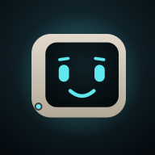
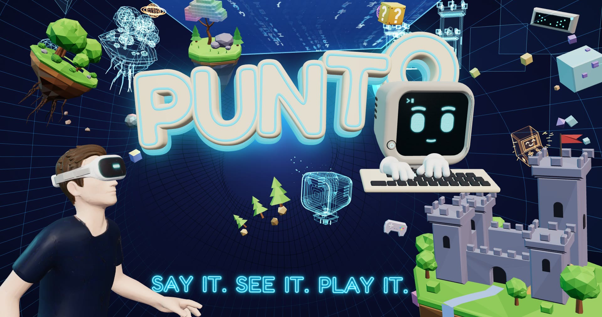
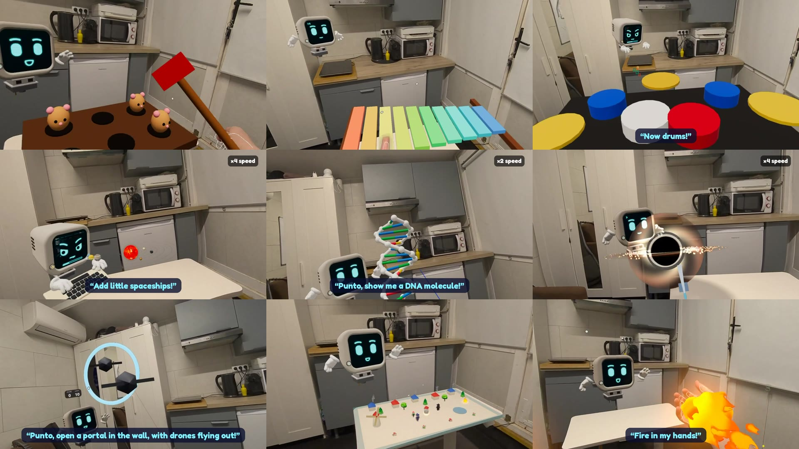
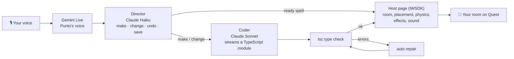

<div align="center">



# Punto

### Say it — and it appears in your room.

A tiny robot lives behind your walls. Point, pinch and say what you want:<br/>
he codes it live, and it appears in your real room.

[](https://www.meta.com/quest/)
[](https://iwsdk.dev)
[](https://www.typescriptlang.org/)
[](https://threejs.org/)
[](https://www.anthropic.com/claude)
[](https://ai.google.dev/gemini-api/docs/live)
[](https://cloud.google.com/run)

**Built for the [Meta VR Start Developer Competition 2026](https://developers.meta.com/vr/start/)**

[How it works](#how-it-works) · [Run locally](#run-locally)

<br/>



</div>

---

## What it is

You hear knocking inside your real wall. A crack opens, and a small robot squeezes out while you pull
the broken pieces away with your hands. That's **Punto**. He asks you to say *"fix it"* — and the wall
heals: your first spell.

Then just talk to him:

| You say | Punto builds |
|---|---|
| *"The solar system on my coffee table"* | Planets with real NASA textures, orbiting on your real table |
| *"A village in the forest, with little people walking"* | A tabletop diorama that stands on your table top |
| *"A blaster, and targets on that wall"* | A tool in your hand and targets anchored to your real wall |
| *"A piano"* · *"drums"* · *"a xylophone"* | Instruments you play with your fingertips |
| *"A water molecule I can hold"* | A real molecule (PubChem), in your hands |
| *"Make it bigger"* · *"make it red"* · *"undo"* | Changes in seconds, 20 versions kept |

No code on screen, no menus, no controllers — your voice, your hands and your room.

<p align="center"><br/><sub>Captured in passthrough on Meta Quest — every thing here was coded live by Punto from one spoken sentence.</sub></p>

## Features

- 🧱 **Mixed reality first** — passthrough, scene understanding (walls, floor, tables, sofa), hit test and
  anchors: things land where you point and stay there.
- ✋ **Hands, not controllers** — pinch to talk, touch to play, grab, pull and throw.
- 🗣️ **Natural voice** — a live voice conversation with Punto, in English or Russian.
- ⚡ **Watch it being built** — the code streams onto Punto's screen while parts of the thing appear one by
  one; the old version burns away as a ghost.
- ↩️ **Undo / redo by voice** — every change is a version; *"go back"*, *"no, the new one was better"*.
- 📚 **Library** — say *"save"* to keep a creation; saved ones replay instantly, without any AI call.
- 👥 **Many players at once** — every browser gets its own Punto and its own history.

## How it works



The model writes only **the idea** — a small TypeScript module against a typed host API (`tools/coder-api.d.ts`).
The **host** does the hard, reliable parts: finding surfaces in your room, placing and anchoring, hands,
physics, effects, sound, and a library of ready parts (characters, planets, molecules, instruments,
99 ready things). Generated code never runs on the server — only `tsc --noEmit` does.

## Tech stack

| Layer | |
|---|---|
| XR runtime | [IWSDK](https://iwsdk.dev) (WebXR, ECS) · three.js · Havok physics · Quest browser, no install, installable PWA |
| Voice | Gemini Live (conversation) · Chirp 3 (speech-to-text fallback) |
| Agents | Director: Claude Haiku · Coder: Claude Sonnet (via OpenRouter, prompt caching) |
| Server | Node.js · Express · Google Cloud Run · Cloudflare Worker in front |
| Content | Poly Haven skies (CC0) · Kenney sounds (CC0) · NASA planet textures · PubChem molecules |

## Project layout

```
src/            the page: Punto, the live loop, the way in through the wall, placement, drafts, hands
  features/     the creations the coder writes (one TypeScript module each)
  style/        the host's building blocks: houses, trees, characters, props
  instruments/  piano, drums, xylophone, marimba, kalimba — played by fingertips
server/         /api: voice, director, coder, versions & undo, library, limits
tools/          the coder (coder.mjs), its prompt and typed API, compile & checks
knowledge/      what the coder is taught, topic by topic
samples/        example creations
edge/           the Cloudflare Worker in front of Cloud Run
public/         sounds, voice lines, textures, models, icons
```

## Run locally

Requires Node.js 22+ and a Meta Quest (or the IWER emulator that opens with the dev server).

```sh
npm install && (cd server && npm install)

# server/.env
#   PUNTO_KEYS=me:some-local-key
#   OPENROUTER_API_KEY=...
#   CODER_BACKEND=openrouter
#   CODER_OR_MODEL=anthropic/claude-sonnet-5.5
#   PUNTO_DIRECTOR_OR=anthropic/claude-haiku-5.5
#   CODER_PROMPT=bare
# Gemini Live and Chirp use Google Cloud: gcloud auth application-default login

node --env-file=server/.env server/index.mjs   # the Punto server, :8787
npm run dev                                     # the page, with the IWER emulator
```

Open the page with `?key=some-local-key&voice=live`.
On a Quest connected over USB: `node tools/quest.mjs open "voice=live"`.

```sh
npm test    # type check + syntax check of every server/tools/edge script
```

## Credits

- 3D models: [Poly Pizza](https://poly.pizza), CC0 — see `public/models/polypizza/CREDITS.md`
- Skies: [Poly Haven](https://polyhaven.com), CC0 · Sounds: [Kenney](https://kenney.nl), CC0
- Built on [IWSDK](https://github.com/facebook/immersive-web-sdk) by Meta

<div align="center">
<br/>
Made solo · November 2026
</div>
